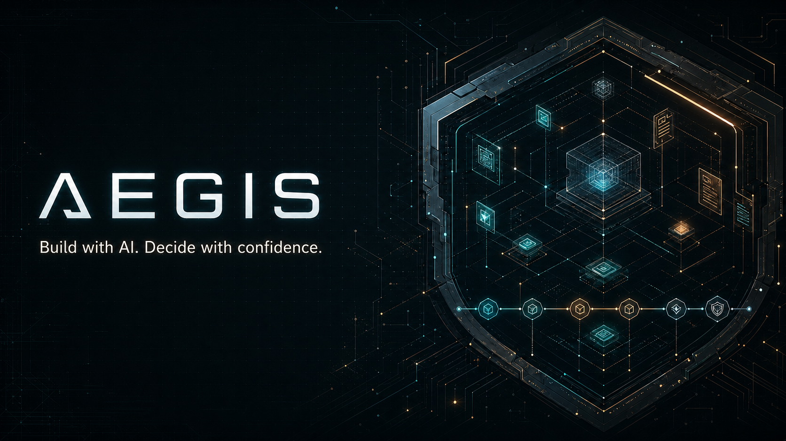

# Aegis v2: Leaner and Meaner

Aegis helps an AI coding assistant turn an idea into bounded work, tested changes, and reviewable decisions. It keeps the useful stage gates while scaling the paperwork to the actual risk.

This is a local publication candidate, not a published release. It contains the tested lean workflow with the invocation renamed to `$aegis2`. It does not include a model-selection dialog or an automated enforcement engine.

## How it works

The PM coordinates scope, requirements, delegation, evidence, and communication without implementing product changes. Coder, Tester, SecOps, and Documentation roles do the work needed for the assignment. Independent review remains independent of the coordinating PM.

The nine gates remain: scope, build package, pre-code review, execution authorization, acceptance, commit, deployment, post-deployment acceptance, and push/PR/closeout. Applicability and evidence scale with risk. Explicit owner delegation can authorize bounded routine development decisions; it does not authorize new spending, expanded scope, production promotion, or public release.

Each governed project has one current `spec.md`. Run-specific build packages refer to that specification rather than creating competing specifications. Decisions and verification evidence remain inspectable.

Aegis is procedural guidance for an assistant, not a sandbox, permission system, or guarantee that an agent cannot leave its mandate. Host permissions and human review still matter.

## Install

Copy the complete `skill/aegis2` folder, including its `agents` and `references` folders, into your Codex personal skills directory, normally `~/.agents/skills/aegis2`, or your repository's `.agents/skills/aegis2`. Use the skill directory supported by your host installation. Keep a backup of an older Aegis installation outside active skill-discovery folders before deactivating it. Do not delete project records or the old source history.

Windows PowerShell and WSL are separate hosts. Install in each host where you intend to run Aegis, or deliberately arrange a shared readable source. Start a fresh Codex session and confirm it discovers `aegis2`; old sessions may retain the prior skill.

Before starting Codex, create and enter the project directory. A shell's current directory is not changed by a request to save the final result somewhere else. Verify the actual working directory and writable scope before any file creation. Never start a trial inside a credentials directory.

## Getting started: calculator demo

1. Follow the install steps above, then open a fresh Codex session in an empty,
   isolated project folder. Before any writes, confirm the loaded aegis2 skill
   source, actual working directory, and writable scope.
2. Open the [baseline prompt](examples/calculator/calculator-create.md) and
   paste its text block into Codex. Expect a self-contained offline calculator
   with keyboard support, tested arithmetic, and recoverable errors.
3. After reviewing and accepting the baseline, paste the
   [percent prompt](examples/calculator/calculator-percent.md) into the same
   project. Expect unary percent: 5% = 0.05, 50 × 5% = 2.5, and
   200 + 10% = 200.1. Keep the original regression checks.

Keep all project outputs in the isolated folder. Neither step requires a
commit, deployment, or publication. The Hermes port is not included.

## Models and effort

Use an approved project mapping to models actually available in the host. Record the actual model and reasoning route when exposed; otherwise mark them unknown. The proposed per-role model/effort/speed selection dialogue is not included in this candidate.

## Validation and limits

Owner-provided PowerShell and WSL Codex session reports exercised a new calculator and a small percent enhancement using the lean UAT source. Both reported test-first work, regression checks, independent reviews and scoped gate closure. PowerShell used Firefox; WSL used Chromium with owner-run assistance when the automated browser sandbox was unavailable. These are owner-reported outcomes from the earlier lean source. A fresh rerun of this packaged example was deferred; no new calculator pass is claimed.

The percent iteration reported 98 PowerShell acceptance cases plus the archived 58-case regression, and 102 WSL core cases plus the archived 63-case regression. Browser reports covered 20 Firefox groups and 31 Chromium checks. Counts are different suites, not a quality ranking or a controlled speed benchmark. No screen-reader certification, hard agent-containment proof, universal host compatibility or performance guarantee is claimed.

Packaging checks verify the six-file identity and privacy scan separately. See `RELEASE-NOTES.md` for candidate boundaries.

## Creator and license

Created by David A. Frey.

Copyright (c) 2026 David A. Frey. Licensed under the [MIT License](LICENSE). You may use, modify, and redistribute this work, including commercially, subject to the license terms. Keep the copyright and permission notice with copies or substantial portions.
